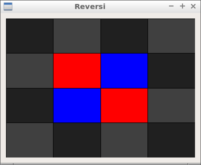

# Reversi

Reversi is a clone of the classic board game,
written in C++ using Qt,
and one of
[Richèl Bilderbeek's games](https://richelbilderbeek.github.io/games).

- [Building](build.md)
- [Manual](manual.md)
- [Play it](play.md)
