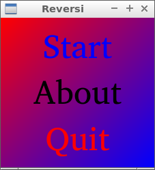
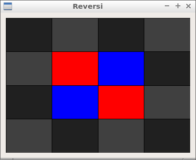

# Manual

Reversi is a two-player board game.

## Goal

Have the most pieces of your color on the board
when the game ends.

## Gameplay

Players take turns placing one piece of their color on the board.

A move is only valid if it flanks one or more of
the other player's pieces:
these pieces must lie in a straight line
(horizontally, vertically or diagonally)
between the new piece and another piece of the current player.
All flanked pieces then flip to the current player's color.

If a player cannot make a valid move, he/she must pass.

The game ends when neither player can make a valid move.
The player with the most pieces wins.

